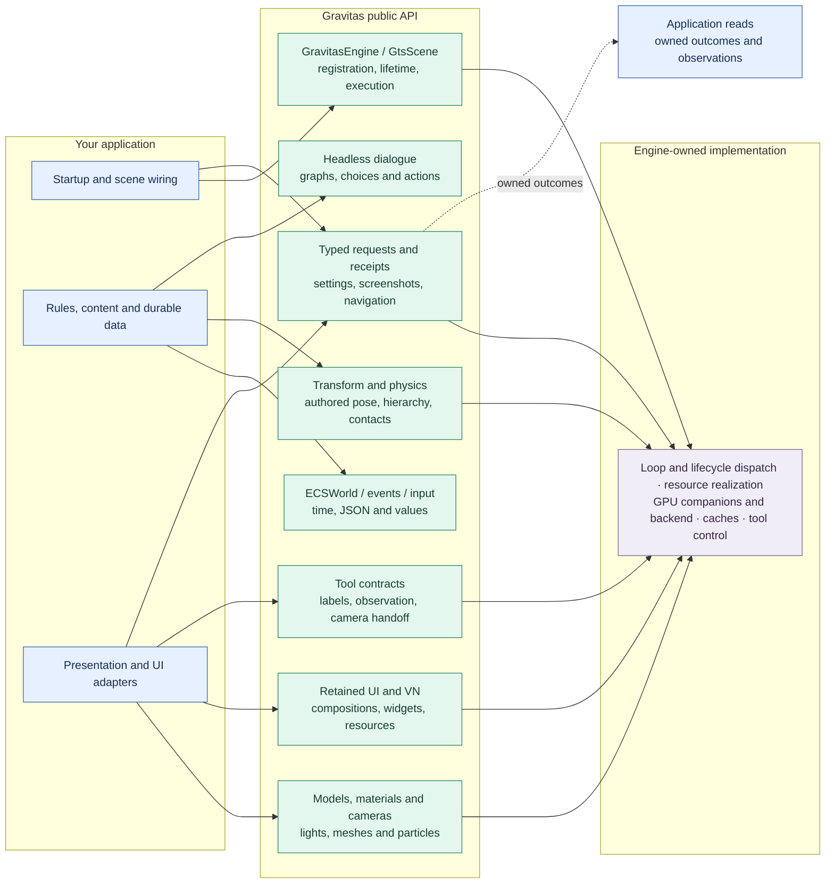

# Gravitas API

Gravitas is a C++20 engine exposing scenes, ECS state, events and feature-specific
capabilities. Applications own their rules and content. They describe what to
present, submit typed requests and inspect supported results; the engine owns
the loop, resource realization, rendering, synchronization and platform services.

This is the public integration reference. Paths are relative to the Gravitas
repository root. In the DungeonCrawler checkout that root is `engine/`, so
`engine/core/` here means `engine/engine/core/` from the game root. Include headers
by basename through their owning CMake target, not private relative source paths.
Exact declarations are linked below. Existing `.hpp` filenames remain part of the
current API; new implementations follow the paired-header/source coding standard.

Jump to [startup](#start-an-application),
[ownership and scenes](#ownership-scenes-and-execution),
[ECS/input](#ecs-state-events-and-input),
[transforms/rendering](#transforms-camera-and-rendering-descriptors),
[materials](#materials), [models/animation](#models-instances-and-animation),
[physics](#physics-contacts), [UI/narrative](#retained-ui-and-narrative),
[requests/results](#typed-requests-and-observed-results),
[assets/cooking](#json-assets-and-cooking), or
[tooling/captures](#tooling-diagnostics-and-captures).

## API at a glance



Solid arrows show supported entry points and implementation ownership, not every
CMake dependency. The dashed arrow is an owned result returning to the caller.
Headless dialogue and core values work without a rendered UI. Presentation
adapters consume their own capabilities; ordinary rules do not manipulate UI,
GPU state, resource caches or engine command consumers.

### Choose the owning capability

| Need | CMake target | Principal headers |
| --- | --- | --- |
| Complete engine host | `gravitas_runtime`, or full `gravitas_engine` / alias `GravitasEngine` | `GravitasEngine.h`, `EngineConfig.h` |
| Scenes, ECS, events, input, JSON, time and math | `gravitas_core` | `GtsScene.hpp`, `ECSWorld.hpp`, `EcsSimulationContext.hpp`, `EcsControllerContext.hpp`, `GtsCommandBuffer.h`, `InputBindingRegistry.h`, `GtsJsonParser.h`, `GlmConfig.h` |
| Gravitas execution recipes | `gravitas_runtime_execution` | `SceneExecutionProfile.h`, `BuiltinExecutionGroups.h`, `SceneExecutionPolicy.h`, `VNExecutionProfiles.h` |
| Transform/hierarchy | `gravitas_transform` | `TransformComponent.h`, `TransformDirtyHelpers.h`, `TransformHierarchyHelpers.h`, `WorldTransformComponent.h`, `TransformSceneFeature.h` |
| Collision observations | `gravitas_physics_contracts` | `IGtsPhysicsModule.h`, `CollisionEvent.h`, `ScenePhysics.h` |
| Collision feature installation | `gravitas_physics` | `PhysicsSceneFeature.h`, `PhysicsBodyComponent.h`, `SphereColliderComponent.h` |
| Model requests, world occurrences and animation | `gravitas_model_frontend` | `GtsModels.h`, `ModelInstanceComponent.h`, `GtsModelHandle.h`, `GtsModelClipReference.h` |
| CPU material authoring | `gravitas_material_frontend` | `MaterialRuntime.h`, `MaterialReferenceHelpers.h`, `MaterialReferenceComponent.h` |
| Rendering scene authoring | `gravitas_rendering` | `RendererSceneFeature.h`, camera/mesh/light/particle descriptors, `UiSystem.h`, `UiComposition.h`, `UiWidget.h` |
| Rendering frame observations | `gravitas_rendering_controller_contracts` | `RenderingControllerContext.h` |
| Window/configuration values | `gravitas_rendering_window_contracts` | `GraphicsConfig.h`, `GraphicsSettings.h`, `GraphicsMonitorInfo.h` |
| Rendering requests/results | `gravitas_rendering_command_contracts` | `RenderEngineCommands.h`, `GraphicsSettingsRequest.h`, `ScreenshotCommand.h` |
| UI font/texture acquisition | `gravitas_rendering_ui_resources` | `IUiResourceProvider.h` |
| Retained UI values and services | `gravitas_ui` | `UiEvent.h`, `UiLayout.h`, `UiTheme.h`, `UiMountTypes.h`, `UiBindingTypes.h`, `UiControllerContext.h` |
| Headless dialogue | `gravitas_dialogue` | `DialogueTypes.h`, `DialogueRegistry.h`, `DialogueRuntime.h`, `DialogueSystem.hpp` |
| VN/frontend adaptation | `gravitas_visualnovel` | `VNRuntime.h`, `VNSystem.hpp`, `VNPresentationProfile.h`, frontend/playback/session components |
| Tool metadata/startup observations | `gravitas_tool_contracts` | `ToolEntityLabelComponent.h`, `EngineToolQueries.h`, `ToolCameraHandoff.h`, `ToolLaunchPreset.h` |
| CPU authoring-manifest IO | `gravitas_tool_asset_manifest` | `AssetManifest.h` |
| Read-only frame telemetry | `gravitas_profiling` | `GtsFrameStats.h`, `ISceneFrameStats.h` |
| Shared asset values / offline cooking | `gravitas_asset_contracts`, `gravitas_cooked_assets`, executable `assetc` | `GtsStaticVertex.h`, `TextureColorSpace.h`; cooker CLI below |

`gravitas_model_frontend` composes lower model targets, including world creation,
instances and controller contracts; prefer it for application model integration.
Link the narrow target when only values, authoring or observations are needed.
Do not obtain a missing header by exporting a source parent or linking an entire
runtime/tools implementation. An application's own policy may restrict which
roles consume an otherwise public capability. Engine test-subject access does
not make an implementation a supported application API.

## Start an application

The [runtime facade](engine/runtime/GravitasEngine.h) owns its implementation and
is noncopyable. `EngineConfig` owns graphics, simulation and tool startup values.
Its defaults select the normal engine composition. The complete facade currently
requires rendering, Vulkan, tools, debug draw and physics targets. Disabling one
omits the full facade; use available leaf capabilities for a reduced/CPU-only
program. Hiding tools at runtime does not remove their build dependency.

For an external CMake host, adjust the engine source path:

```cmake
cmake_minimum_required(VERSION 3.20)
project(ExampleApplication LANGUAGES CXX)
add_subdirectory(path/to/Gravitas gravitas)
if(NOT TARGET GravitasEngine)
    message(FATAL_ERROR "This application needs the complete Gravitas runtime")
endif()
add_executable(example main.cpp ExampleScene.cpp ExampleScene.h)
target_compile_features(example PRIVATE cxx_std_20)
target_link_libraries(example PRIVATE GravitasEngine)
```

The following paired scene is a minimal camera-only host. It deliberately renders
an empty world; add application entities/resources afterward. The methods are
required scene interface overrides. Scene installers and descriptors need their
own headers; the facade does not implicitly publish their implementations.

`ExampleScene.h`:

```cpp
#pragma once
#include "GtsScene.hpp"

class ExampleScene final : public GtsScene
{
public:
    void onLoad(EcsControllerContext& ctx, const GtsSceneTransitionData* data) override;
    void onUpdateSimulation(const EcsSimulationContext& ctx) override;
    void onUpdateControllers(const EcsControllerContext& ctx) override;
};
```

`ExampleScene.cpp`:

```cpp
#include "ExampleScene.h"
#include "CameraDescriptionComponent.h"
#include "RendererSceneFeature.h"
#include "RenderingControllerContext.h"
#include "SceneExecutionPolicy.h"
#include "TransformComponent.h"

void ExampleScene::onLoad(EcsControllerContext& ctx, const GtsSceneTransitionData*)
{
    resetSceneWorld();
    gts::rendering::installRendererFeature(*this, ctx, gts::execution::rendererExecutionInputs());
    const Entity cameraEntity = ecsWorld.createEntity();
    TransformComponent pose;
    pose.position = {0.0f, 1.0f, 4.0f};
    CameraDescriptionComponent camera;
    camera.active = true;
    camera.target = {0.0f, 0.0f, 0.0f};
    const auto& view = gts::rendering::controllerContext(ctx);
    camera.aspectRatio = view.sceneViewportAspectRatio > 0.0f
        ? view.sceneViewportAspectRatio : view.windowAspectRatio;
    ecsWorld.addComponent(cameraEntity, pose);
    ecsWorld.addComponent(cameraEntity, camera);
}

void ExampleScene::onUpdateSimulation(const EcsSimulationContext& ctx)
{
    ecsWorld.updateSimulation(ctx);
}

void ExampleScene::onUpdateControllers(const EcsControllerContext& ctx)
{
    ecsWorld.updateControllers(ctx);
}
```

`main.cpp`:

```cpp
#include "ExampleScene.h"
#include "GravitasEngine.h"
#include <memory>

int main()
{
    GravitasEngine engine;
    engine.registerScene("main", [] { return std::make_unique<ExampleScene>(); });
    if (!engine.setActiveScene("main"))
        return 1;
    engine.start();
}
```

`registerScene` retains a factory returning exclusive scene ownership, plus
optional `RegisteredSceneInfo`. Re-registering an ID replaces that entry.
`setActiveScene` is synchronous host integration; check its boolean result.
`start()` runs the loop and coordinated shutdown and requires a loaded scene.
Construction, factory, load and platform/resource failures can throw; choose the
host's top-level error reporting. Destruction also unloads a scene if `start()`
never ran or unwound. This is not a scene-load rollback facility.

Configure project paths before using application persistence. `GtsPaths` exposes
process-wide project-root configuration, not a universal asset search guarantee.
The host owns resource copying/cooking and its working directory. For
DungeonCrawler, launch from its `build/src/`, where copied resources exist.

## Ownership, scenes and execution

| Object | Owner / valid use |
| --- | --- |
| Engine instance | Host; factories and captured session objects must remain valid while used |
| Active scene and `ECSWorld` | Runtime/scene; replacement destroys the old scene |
| `Entity`, UI handle, material handle | Identity in its originating live world/document/runtime; never a save-file or cross-scene identity |
| Frame context and module/service pointers | Non-owning borrow for the current call; do not cache, delete or adopt into smart owners |
| Scene resource reference | Scene-owned; valid until scene reset/destruction |
| Event argument / component view | Immediate callback/query borrow; copy needed values before returning or invalidating storage |
| Model handle | Shared immutable resource; retains content, not a world or runtime service |
| Model clip reference | Non-owning identity within its retained model resource |
| Graphics receipt | Owned shared const observation; may outlive frames/scenes, read on engine thread |
| Durable game/session snapshot | Application-owned plain values; no outgoing-world IDs, services, UI state or GPU bindings |

[GtsScene](engine/core/scene/manager/GtsScene.hpp) exposes `onLoad`, fixed-step
`onUpdateSimulation`, per-frame `onUpdateControllers` and `onUnload`. Its protected
world and `resetSceneWorld()` support scene implementation. Reset clears systems,
entities/subscriptions, registered world state, scene resources and feature
installation bookkeeping. Clearing only the world does not release scene resources.

`createSceneResource<T>(args...)` creates one exact unqualified object type;
duplicate creation throws before constructing another. `findSceneResource<T>()`
returns a borrowed pointer or null, without creating anything.
`requireSceneResource<T>()` returns a borrow or throws `std::logic_error`.
These are generic ownership operations; feature access belongs to its feature API.

On a switch the runtime validates the destination, synchronizes graphics,
runs module unload hooks, clears retained UI borrowers, unloads/resets/destroys
the old scene, then constructs and loads the destination through its module hooks.
Unknown IDs leave the old scene intact. A registered factory/load exception can
occur after teardown and propagates; there is no general rollback. Direct
destruction of an isolated scene does not invoke its virtual `onUnload`.

Simulation systems derive from `ECSSimulationSystem` and receive
`EcsSimulationContext { world, dt, input }`; controllers derive from
`ECSControllerSystem` and receive a frame context. The world owns systems added
with `addSimulationSystem<T>(group, args...)` or `addControllerSystem<T>(group, args...)`.
Registration order matters. Explicit groups/selections determine participation;
use `SceneExecutionProfile`/`BuiltinExecutionGroups` when composing Gravitas.
Modules accept supplied selections/groups and do not import those runtime recipes.

Authoritative mechanics use fixed simulation `dt`; UI, animation presentation,
debug cameras and tools use their established controller timing. Pause can stop
simulation while controllers continue. VN overlay/fullscreen policies select
groups explicitly. Preserve writer/resolver/consumer order and existing command
flush boundaries; fixed timestep alone does not promise cross-engine/platform
determinism. Queued ECS structural commands flush after the current system.

## ECS state, events and input

[ECSWorld](engine/core/ecs/world/ECSWorld.hpp) creates/destroys entities, stores
components/singletons, registers systems and dispatches typed events. Add/check
components with `addComponent`, `hasComponent` and `getComponent`. References can
be invalidated by structural changes/archetype relocation: reacquire rather than
holding them across mutations. Use `world.commands()` for deferred structural edits
when iterating. `forEachNonstructural` explicitly rejects immediate structural
mutation; its row references must not escape the call.

`publish(event)` calls subscribers synchronously before returning on the engine
thread. `subscribe<Event>(handler)` returns a `SubscriptionToken`; keep that token
for as long as the handler should be active. Destroying it unsubscribes. Handlers
may copy semantic values into later work, but must not retain the event argument
or synchronously destroy their own scene. World reset releases scene subscriptions.
The platform event bus is separate infrastructure, not the application domain bus.

[InputBindingRegistry](engine/core/input/binding/InputBindingRegistry.h) maps
named actions to `InputTrigger`, activation mode, context and pause policy.
Startup registers defaults; settings code persists/rebinds only actions it owns.
`bindDefaults` preserves actions that already have bindings, but does not retain
an explicitly unbound action as a separate default override.

| Operation | Intended caller / timing |
| --- | --- |
| `bind`, `bindDefaults`, `unbind`, `unbindAll`, `rebind` | Startup/settings integration; do not erase another owner's actions |
| `pushContext`, `popContext`, `clearContextStack` | Explicit modal/context owner; balance entry and exit |
| `isHeld`, `axisValue` | Action state consumers |
| `isPressed`, `isReleased` | Frame controllers; current frame edges |
| `isSimulationPressed`, `isSimulationReleased` | Fixed simulation; edges latched across frames without ticks and consumed once |
| `update(InputSnapshot)`, simulation-edge completion | Runtime/input integration, not mechanics |
| `getRoutingConflicts`, trigger/binding queries | Read-only diagnostics/settings |

Contexts route newest-first, then global. Passthrough bindings observe without
reserving input. Exclusive bindings reserve against lower contexts; distinct
exclusive sibling actions claiming the same input are suppressed and reported.
Paused gameplay bindings neither evaluate nor reserve input. The registry does
not replace UI pointer capture/modal routing or application input-block reasons.
Engine commands run before UI dispatch; application controllers must publish
semantic gating at the right frame boundary. `IInputSource` is the platform/test
sampling boundary, not something stored in gameplay snapshots.

## Transforms, camera and rendering descriptors

Author [TransformComponent](engine/modules/transform/components/TransformComponent.h)
local position/rotation/scale. After changing an existing live transform, call
`gts::transform::markDirty(world, entity)` from `TransformDirtyHelpers.h`.
`WorldTransformComponent` is resolved/published state for readers. Hierarchy
attachment/detachment uses `TransformHierarchyHelpers.h`, including explicit
preserve-local/preserve-world behavior; do not maintain a second hierarchy resolver.

`installTransformRuntime` installs lifetime and component callbacks without
scheduling a controller. `installTransformResolver` appends resolution at the
caller's chosen registration position. `installTransformFeature` combines both.
Install writers before the resolver and consumers afterward. Physics also resolves
before contacts. Scene overloads guard feature installation; low-level world
installers are explicit operations and do not reorder/deduplicate systems for you.

Rendering installs through
[installRendererFeature](engine/modules/rendering/scene/RendererSceneFeature.h).
It owns the concrete registration order, scene/world resource borrowing,
descriptor companions and teardown. Resource providers must outlive installed
consumers. Public authoring does not entail explicit renderer cache resets.

| Authoring surface | What the application supplies |
| --- | --- |
| `CameraDescriptionComponent` + `TransformComponent` | Active camera, eye pose, target/up, FOV, aspect and near/far planes |
| `CameraControlOverrideComponent` | Application-owned camera input, retaining the normal matrix pipeline |
| `StaticMeshComponent`, `QuadMeshComponent`, `DynamicMeshComponent` | Direct/procedural geometry intent; update authoritative dynamic-mesh versions as required |
| `MaterialReferenceComponent` | World-scoped CPU material identity |
| `DirectionalLightComponent`, `PointLightComponent` | Lighting intent |
| `ParticleEmitterComponent`, `TextureAnimationComponent` | Effect/animation authoring values; simulation/extraction remains engine-owned |
| `RenderableRuntimeStatus`, `ActiveCameraViewStateComponent` | Read-only readiness/projection observations, never authoring state |

Rendering computes view/projection matrices and Y inversion, owns GPU camera
companions/buffers and uploads after the appropriate frame fence. Do not allocate
camera/object slots, write GPU components or manually reproduce that pipeline.
Editing camera active/target/lens values requires no private GPU dirty flag.
Use the observed active-camera view for UI projection, not as a mutable camera.
Tool camera finalization may occur after ordinary controllers; validate a completed
frame when observing takeover. Keep camera aspect synchronized with the actual
scene viewport/window as the surface changes.

## Materials

[MaterialRuntime.h](engine/modules/rendering/core/material/authoring/MaterialRuntime.h)
and `MaterialReferenceHelpers.h` expose a compiled CPU authoring surface without
Vulkan. `materialRuntime(world)` borrows/creates that world's material runtime.
Its identities and borrowed views are invalid after world teardown; reacquire
views after mutations/creation that can move storage.

| API | Effect |
| --- | --- |
| `createDefinition`, `createInstance`, `cloneInstance` | Create world-local material identities; cloning provides independent instance state |
| `getDefinition`, `getInstance` | Const borrowed views |
| `setInstance`, `modifyInstance` | Sanitize/update CPU values, advance versions and enqueue synchronization; callback is immediate and must not retain its mutable reference |
| `destroyInstance`, `destroyDefinition` | Reject stale/built-in identities; live instance references prevent definition destruction |
| `createUnlitMaterial(world, descriptor)` | Unique mutable unlit material |
| `sharedUnlitMaterialReference`, `getOrCreateSharedUnlitMaterial` | Share identical authored material within one world; mutations affect all its users |
| `getOrCreateSharedCookedMaterial` | Share a cooked `.gmat` path within one world |
| `frameState`, `lifetimeToken` | Owned read-only snapshot / weak lifetime observation, not ownership of the world |

For example, inside application presentation setup with an existing `world`,
`entity` and `UnlitMaterialDescriptor descriptor`, include `ECSWorld.hpp`,
`MaterialReferenceHelpers.h` and `MaterialReferenceComponent.h` explicitly:

```cpp
const auto material = gts::rendering::createUnlitMaterial(world, descriptor);
world.addComponent(entity, MaterialReferenceComponent{material});
```

Use `modifyInstance` for subsequent semantic edits; never mutate a const view or
drain internal dirty queues. The engine owns texture realization, backend handles
and material cache registries. A descriptor path ending in `.gmat` uses the cooked
material route rather than being interpreted as an image. Material load failures
remain explicit diagnostics/exceptions. Handles cannot be persisted or reused
in another world, even if their numeric values happen to match.

## Models, instances and animation

[GtsModels.h](engine/modules/model/public/GtsModels.h) is the application entry
point. During scene setup, `modelInstances(world, ctx)` configures access to
engine-owned realization services. Later `modelInstances(world).create(handle)`
creates an owned occurrence; it is a world creation service, not a registry of
mutable application instances. Do not construct/import/cache models yourself to
get around this API.

Inside scene/presentation setup, this fragment attaches a static or animated
model after checking both load and instance creation. Include `GtsModels.h`,
`ECSWorld.hpp` and the standard `<stdexcept>`, `<memory>` and `<utility>` headers:

```cpp
const auto loaded = requestGtsModel(ctx, GtsModelRequest{"resources/models/actor.glb", {}});
if (!loaded.succeeded())
    throw std::runtime_error("Actor model load failed; inspect loaded.diagnostics()");
auto created = modelInstances(world, ctx).create(loaded.handle());
if (!created.succeeded())
    throw std::runtime_error("Actor instance creation failed; inspect created.diagnostics");
world.addComponent(entity, ModelInstanceComponent{
    std::shared_ptr<GtsModelInstance>(std::move(created.instance))});
```

Replace the path with existing content and report the supplied diagnostic list
in the host's error UI/log. `GtsModelRequest::requiredCapabilities` can require
geometry, hierarchy, skeletons, skin bindings and animations; do not assume a
static cooked definition satisfies an animated request. `GtsModelRequestResult`
exposes `succeeded()`, immutable `handle()` and `diagnostics()`.

The handle is a shared immutable `GtsModelResource`. Instance creation returns a
`unique_ptr<GtsModelInstance>` plus diagnostics. `ModelInstanceComponent` uses
shared ownership to keep the mutable occurrence stable across ECS component copies;
create a different instance for each actor requiring independent animation.
Sharing a model handle shares content/geometry, not independent playback state.

`findGtsModelClip(handle, name, optionalSkeletonUse)` returns a checked optional
resource-scoped clip reference plus diagnostics. The application chooses semantic
names; the engine owns clip data, playback and poses. Inspect
`gtsModelSkeletonUseCount` rather than assuming one skeleton use. Instance methods
include `play(use, clip)`, `stop(use)`, `setPlaybackPolicy(use, speed, looping)` and
`updateAnimations(deltaSeconds)`, returning status/diagnostics. A clip from another
resource is invalid. Do not persist clip indices without their content identity.

Entity `TransformComponent` remains authoritative placement; an instance has no
second world transform. Generic extraction combines it with model hierarchy,
materials and static/skinned occurrence state. The application neither builds
skin palettes nor uploads bone matrices. Material overrides are per slot or
model-wide and must belong to the same live material runtime; teardown invalidates
associations even if a shared instance object survives. Rebinding is explicit.

## Physics contacts

[installPhysicsFeature](engine/modules/physics/scene/PhysicsSceneFeature.h)
accepts a scene, controller context, default selection and simulation group.
Integration supplies Gravitas's Physics group; the module owns concrete world
construction, transform preparation and fixed-step registration. Repeated scene
installation is guarded until scene reset.

`findScenePhysics(scene)` in
[ScenePhysics.h](engine/modules/physics/contracts/ScenePhysics.h) returns an
optional borrowed `IGtsPhysicsModule*`; `requireScenePhysics` returns a borrow or
throws `std::logic_error`. Const-scene overloads return const access. Lookup does
not install or own physics. Application contact consumers use const access and
`getCollisions()`; runtime/system integration owns update/clear, not gameplay.

Entities participate through `WorldTransformComponent`, `PhysicsBodyComponent`
and `SphereColliderComponent`. Static/static pairs are skipped. Contacts are
world-local pairs valid until the next physics update/clear; validate entity
liveness and copy/deduplicate semantic effects before retaining work. Treat a
contact as a discrete application input, not an automatic reward/pickup/transition.

Current physics is sphere collision detection, not a rigid-body response solver.
There are no mass/velocity/force/impulse/friction/constraint guarantees or generic
character controller. Application movement/blocking rules remain application-owned.

## Retained UI and narrative

UI authoring follows **surface → layer → mount → composition → widget → node**.
[UiComposition](engine/modules/rendering/core/ui/UiComposition.h) provides
`build`, `update`, `onEvent` and `destroy` callbacks with a borrowed
`UiCompositionContext`. `UiSystem::mountComposition(unique_ptr, desc)` transfers
ownership; keep its `UiCompositionId` to update/rebuild/destroy it. Destroying a
composition releases mount focus/navigation/drag-drop/callback state. UI handles
belong to the active document/surface/mount, not the application's saved data.

Use reusable `UiWidget`/`UiWidgetAsset` controls, `UiTheme` tokens and container
layout: Stack, Grid, Dock, Scroll, Constraint, Aspect and Overlay. Handle retained
`UiEvent` in compositions/widgets. Engine services own hit testing, pointer
capture, focus, navigation, modal routing and drag/drop mechanics. Raw nodes and
coordinate layouts are lower-level bridges for specialized visuals/projection,
not the default screen-authoring model.

UI handlers translate semantic application events/requests into frontend state;
domain systems do not mutate concrete retained state. For an immediate
dialogue-to-merchant handoff, the application's handler reports acceptance in the
same call and preserves session identity. The engine provides presentation and
interaction mechanics, not merchant/inventory/story business rules.

[IUiResourceProvider](engine/modules/rendering/contracts/ui-resources/IUiResourceProvider.h)
offers texture/clamped/pixel requests, dimensions and font acquisition/metadata.
It cannot allocate camera buffers/object slots or upload meshes. UI contexts and
`RenderingControllerContext::uiResources` supply this narrow non-owning borrow.
Returned resources follow the provider cache lifetime; no new lifetime is created
by requesting a handle. Include asset color-space values explicitly when selecting
them. Broad `IResourceProvider` allocation is an engine integration/backend concern.

Compositions can borrow scene fonts/grids/VN runtimes. Gravitas destroys retained
borrowers before scene data during runtime unload. If hosting UI independently,
provide the same ordering yourself. Do not keep callback/service/component pointers
after the owning mount, scene or current frame expires.

### Headless dialogue versus VN

`gts::dialogue::DialogueGraph` owns nodes, choices, condition/action identifiers
and argument maps. `DialogueRuntime` owns its active graph/registries and supports
`start`, `advance`, `selectChoice(visibleIndex)`, `refreshVisibleChoices`, `end`
and `isActive`. Check operation booleans/status. Conditions/actions are application
callbacks; the engine does not define quest, affinity or save schemas. Default
unknown actions are ignored and missing nodes end dialogue; configure
`DialogueRuntimeConfig` deliberately when changing those policies.

`DialogueRuntimeComponent`, graph/start-request components, `DialogueSystem` and
semantic dialogue events provide ECS integration. Callback contexts borrow the
current world only for their call. Headless dialogue links core without rendering.

`gts::vn` adds `VNRuntime`, stage/script timing, typewriter and retained frontend
adaptation. `VNSystem` owns runtime integration; `VNPresentationProfile` and
frontend/playback/external-presentation/session components belong to UI/integration.
The VN adapter presents dialogue choices and returns decisions to dialogue; it
does not merge the two runtimes or own application business state. Prefer semantic
`VNInteractionLayout` slots; older coordinate profiles remain compatibility inputs.
Supply `VNExecutionInputs`/runtime profiles from composition so modal entry and
return restore the intended simulation/controller participation.

## Typed requests and observed results

[GtsCommandBuffer](engine/core/command/GtsCommandBuffer.h) is a movable,
noncopyable enqueue-only transport on the engine thread. Core owns storage;
consumption is private. A frame's producer pointer is a current-call borrow.

| Producer operation | Meaning |
| --- | --- |
| `requestChangeScene(name, unique_ptr<GtsSceneTransitionData>)` | Integration moves a destination and optional owned envelope into deferred navigation |
| `requestTogglePause()` | Toggle simulation pause while controllers continue |
| `requestQuit()` | Request coordinated shutdown |
| `requestExtensionCommand(name, std::any)` | Generic transport for capability-owned typed helpers; not permission to invent private command names |
| `gts::rendering::requestScreenshot(commands, directory)` | Typed renderer capture request |
| `requestApplyGraphicsSettings(commands, settings)` | Typed settings request returning owned observation |
| `requestSetFrustumCullingEnabled`, `requestSetFrustumFreeze` | Typed culling controls |

Application integration translates its domain navigation into an engine envelope
derived from `GtsSceneTransitionData`; ordinary persistent values need not inherit
engine transport. The command owns that envelope through destination `onLoad`;
copy/apply its values before returning. An envelope containing raw pointers does
not own their targets. Payload allocation/copy errors propagate normally.

FIFO requests, including repeated names/multiple switches, are retained. Rendering
extensions drain before rendering; remaining lifecycle/pause/quit commands drain
afterward. Writes during detached dispatch wait for a later batch. Unknown scene
IDs reject before unload; unknown extension names have no application guarantee.
Screenshot plus quit can capture the final frame, and shutdown drains pending
image writes. Quit marks loop termination without discarding later FIFO entries
in that already-detached batch.

### Graphics receipts and persistence

[GraphicsSettingsRequest.h](engine/modules/rendering/contracts/commands/GraphicsSettingsRequest.h)
defines `GraphicsSettingsRequest`, a `shared_ptr<const GraphicsSettingsRequestResult>`.
Submit with `requestApplyGraphicsSettings(commands, preferences)`, then inspect
the retained receipt on later controller frames. It owns `requested`, `message`,
`status` and optional `observed` runtime values; it borrows no window/world/backend.
Shared ownership does not make concurrent reads/writes safe: observe on the engine
thread. Dropping your receipt does not cancel application.

| Status | Interpretation |
| --- | --- |
| `Queued` | Transport owns the request; application not attempted |
| `Pending` | Accepted, with deferred output/resource work |
| `Applied` | Application completed; inspect observed values for effective fallbacks |
| `Rejected` | Invalid/unsupported request or unavailable application service; inspect message |
| `Superseded` | A newer accepted settings/culling request replaced unfinished work |
| `Abandoned` | Writer/renderer released unfinished work before completion |

Receipts can survive scene changes and shutdown. Terminal results remain
historical; rejected requests do not replace earlier accepted settings or a pending
receipt. Only engine-private completion publishes status. Headless mode has no
effective window/presentation mode; monitor/present-mode fallback can differ from
accepted requested preferences. `observed` is a published snapshot, not a live query.

Saving preferences is application persistence, independent of application outcome.
A file write can fail while a live request applies, and a saved request can be
rejected by the backend. Report both facts. No generic user-confirmation, rollback,
atomic filesystem replacement or save-format policy is implied by this API.

## JSON, assets and cooking

[GtsJsonParser](engine/core/json/GtsJsonParser.h) parses into owned `GtsJsonValue`
trees with checked access and serializes them. `parse(source, output, error)`
returns a boolean; callers own file IO, schema/version validation, defaults and
diagnostics. Prefer shared parser/value access over new local parsers/escaping.
Applications own their settings/save migration and non-mutation-on-failure policy.

`gravitas_tool_asset_manifest` exposes `gts::tools::loadAssetManifest(path, output,
error)` and `loadAssetManifestOrThrow(path)`. It performs synchronous CPU
file/JSON/schema validation, replacing output only on success; diagnostics retain
the requested path. It does not initialize tools/rendering or guarantee referenced
runtime assets will realize. Manifest bounds/preview settings are authoring values,
not gameplay collision/placement rules. Load at an explicit setup boundary.

Models follow **source → canonical import → optional static cooking → model
resource → world realization → per-entity instance → extraction**. Right-handed,
Y-up, -Z-forward coordinates and authoritative entity placement are the common
convention. Static cooked-v1 products are `.gmesh`, `.gmodel`, `.gmat` and `.gtex`.
Cooked-v1 rejects skeletal/animated content instead of losing animation; animated
source GLB uses the supported development model route until a compatible cooked
format exists. Complete models preserve hierarchy/material ranges; do not assume
every source becomes one flattened mesh.

From the engine root:

```sh
cmake --build build_release --target assetc
build_release/tools/assetc/assetc import tests/assets/fixtures/canonical-cooking/triangle.obj --output /tmp/gravitas-triangle
```

`assetc import <source> --output <directory>` supports OBJ/glTF/GLB/image input,
`--importer obj|gltf|image`, `--base-color-texture`, `--vertex-color-only`,
`--texture-role` and `--single-mip`. Texture roles are base-color,
metallic-roughness, normal, ambient-occlusion, emissive, ui, font-atlas, particle
and data. Color space follows role; font/data/normal channels are linear, ordinary
color/UI/particle textures are sRGB. Cooked/requested color-space mismatches reject
rather than reinterpret pixels. Full mip generation is the default; exact UI/font
images can request a single mip.

Development loading permits source fallback where supported and reports its path.
`GTS_RUNTIME_ASSET_POLICY=strict`, shipping policy or disabled source fallback
requires compatible cooked content. Low-level direct mesh fallback is narrower
than complete-model source loading; use the model API for source glTF/GLB.
Missing/corrupt/unsupported assets produce explicit failure diagnostics; the host
must check them. Source assets are authoring inputs, not disposable build artifacts.

## Tooling, diagnostics and captures

`gravitas_tool_contracts` is core-only and available in reduced builds:

| Contract | Public operation |
| --- | --- |
| `ToolEntityLabelComponent` | Author name/category/selectable metadata on an entity |
| `engineToolsVisibility(const ECSWorld&)` | Owned `optional<bool>` observation: absent, hidden or visible; absence does not install tools |
| `isToolCameraActive(const ECSWorld&)` | Observe camera takeover without internal state access |
| `replaceToolCameraReturnTarget(world, retiring, replacement)` | Replace matching/unset return target while tool camera is active; missing/inactive state is a no-op |
| `ToolLaunchPreset`, `loadToolLaunchPreset(path, output, error)` | Owned startup/capture values; load failure preserves prior output, with no runtime effects |

Camera identities must belong to the same live world, and a replacement must
remain live until restoration. Tools own selection/gizmo/control state. Gizmos
edit authoritative parent-local transforms and use the same transform resolver;
applications do not write tool-state components or inspect preview caches.
Read-only readiness/frame telemetry belongs to developer observation, not rules.

Apply an owned preset with `GravitasEngine::applyToolLaunchPreset` during startup.
The host handles CLI parsing/initial-scene selection; the preset is not a generic
engine command-line parser. Maintained example presets live in
[presets/tooling](presets/tooling). A preset has optional `tools` and `screenshots`
objects. Tools fields include visible, workspace (world/particles/assets), scene,
visualEvaluation, debugDraw, gizmos, particleEffect, assetManifest and selected
emitter/module. Screenshot fields are enabled, afterSeconds, intervalSeconds,
count, directory and exitAfterCapture. Existing workspace aliases/defaults remain.

In a DungeonCrawler checkout, from its `build/src/`:

```sh
./DungeonCrawler --tooling-preset=engine/presets/tooling/editor_eval_world.json --screenshot-directory=/tmp/gravitas-world-capture
```

That host resolves preset paths against its configured project root when needed.
Its Yune presets live in the application `presets/` directory. Capture uses the
renderer-owned path and asynchronous PNG writer, with exit after writes drain;
presets do not simulate UI clicks. Inspect the saved PNG to validate appearance,
and use actual interaction/state tests for behavior. Preset capture success alone
does not verify transactions, collision or input gating.

## Extending and checking an integration

Keep application rules in the application. Select the owning engine capability,
include its supported declarations and honor its borrows/identity scope. When a
needed operation is missing, extend that capability's public contract and paired
implementation; do not reach through a public type into a private cache/backend.
Update this reference and meaningful coverage with an API change. A consuming
project may additionally require explicit source-role/header/target registration.

Build and run the standalone engine checks from its root with a compatible tree:

```sh
cmake -S . -B build_release -DCMAKE_BUILD_TYPE=Release -DBUILD_TESTING=ON
cmake --build build_release --parallel
ctest --test-dir build_release --output-on-failure
```

Engine module/publication checks preserve core/module/runtime direction and reduced
configuration contracts. Tests under `tests/` are executable examples for scenes,
input, materials/cameras, assets/models, UI, dialogue/VN, requests and tooling.
The public contract does not grant test-only implementation access to applications.
Verify real lifecycle/interaction/error paths, not only include visibility.

This boundary organizes the current engine; it does not promise drop-in binary
compatibility with another engine. Replacing Gravitas still requires adapting ECS
identity/access, scenes/execution/input, physics, resources/rendering, UI/VN and
platform/tooling. Keeping rules, durable values and semantic interaction vocabulary
separate makes that work identifiable without adding a second engine prematurely.
