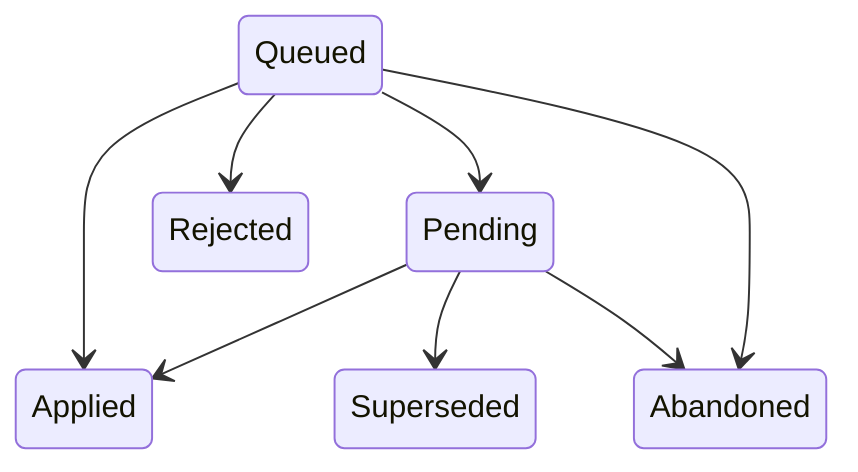

# Graphics settings requests and outcomes

`GraphicsSettingsRequest.h` and `RenderEngineCommands.h` belong to
`gravitas_rendering_command_contracts`, with paired compiled implementations.
The public target depends only on core transport and window/config value contracts.
It exports neither renderer/backend implementation nor result-writing capability.

```cpp
auto request = gts::rendering::requestApplyGraphicsSettings(commands, preferences);
// On a later controller frame, on the engine thread:
const auto status = request->status;
```

The returned `GraphicsSettingsRequest` is a shared pointer to a **const**
`GraphicsSettingsRequestResult`. It owns observation data; it does not borrow a
controller context, world, window or backend. Copies can survive frames, scene
changes, command-buffer destruction and renderer shutdown. Read on the engine/
controller thread: shared ownership does not make concurrent record access safe.
Ignoring the return value preserves the former fire-and-forget calling pattern.

The result contains an owned copy of `requested`, a status, an engine diagnostic
`message` and optional `observed` `GraphicsRuntimeState`. Observation is a snapshot
at the last published transition, not a continuously updated window query. Queued
requests have no observation. Applied/pending/rejected/superseded transitions copy
actual allocated extents, optional presentation/window values and pending state.
Headless operation has no effective window or presentation mode.

| Status | Meaning |
| --- | --- |
| Queued | The writer owns the request; no backend application has been attempted |
| Pending | Backend accepted preferences but output/resource application is deferred |
| Applied | Backend application completed; inspect observed values for supported fallbacks |
| Rejected | Invalid/unsupported request or unavailable application service; diagnostic explains why |
| Superseded | A later accepted graphics/culling request replaced an unfinished request |
| Abandoned | The command writer or renderer released an unfinished request before completion |



Applied/rejected/superseded outcomes remain historical; later commands do not
rewrite completed results. Rejected requests do not replace the earlier accepted
preferences or an earlier pending receipt. A later accepted request supersedes
only the currently pending receipt. Culling-only commands still merge into current
preferences; if accepted, they also supersede an unfinished tracked request.

`RenderingRuntime` consumes the typed command and returns the existing backend
`GraphicsSettingsApplyResult` through the runtime application callback. Accepted
frame pacing/culling changes retain their existing timing. Pending resource work
is retried by the backend; after frame submission, rendering observes its pending
flag and publishes Applied when resource work finishes. No new scheduler phase,
worker, subscription bus or confirmation/rollback policy is introduced.

The engine-private completion owner is distinct from the const observation owner.
Its destructor sets Abandoned for queued/pending records without allocating or
calling user code. Discarding a receipt does not cancel application. Scene unload
removes scene UI while the engine may finish its pending request safely; no old
world/handler pointer is retained. On abandonment, prior diagnostic/observation
values may remain; the terminal status takes precedence.

Completion headers live under `contracts/commands/internal/` and are published
only through `gravitas_rendering_request_completion` to private engine consumers.
Applications must not acquire this target/header or mutate receipt data. The game
build checker rejects direct imports, wrapper exports and direct completion links.
Malformed recognized commands retain the existing consume-without-application
policy; the typed helper always constructs the correct payload.

Persistence is outside this capability. Saving a requested preference is neither
backend acceptance nor application. An unavailable monitor/present mode may use
an effective fallback without erasing the accepted preference. Read `observed`
when that distinction matters; never infer success from submission or logs.

`graphics_settings_requests` covers queued copies, dropped writers, rejection,
missing service, Pending/Applied across scene reset, supersession, culling changes
and renderer shutdown with a controlled backend. Existing real graphics tests
cover headless rejection, windowed resolution and observed monitor fallback.
Game tests cover UI feedback, file failures, separate-process restart and retained
Apply controls against the real runtime.
